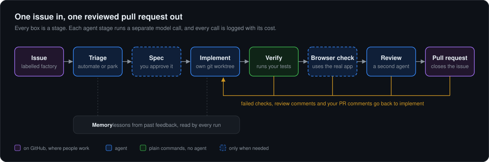
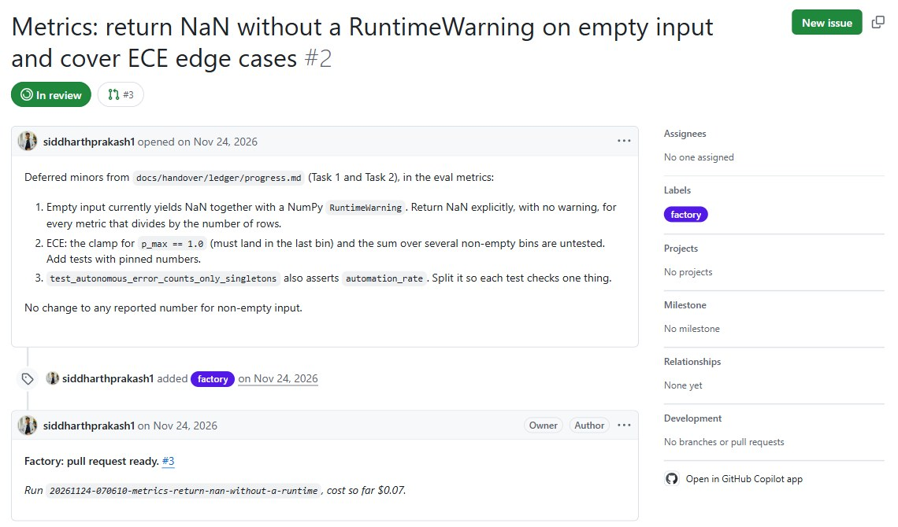
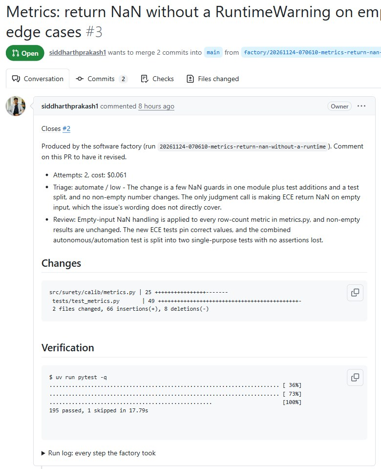
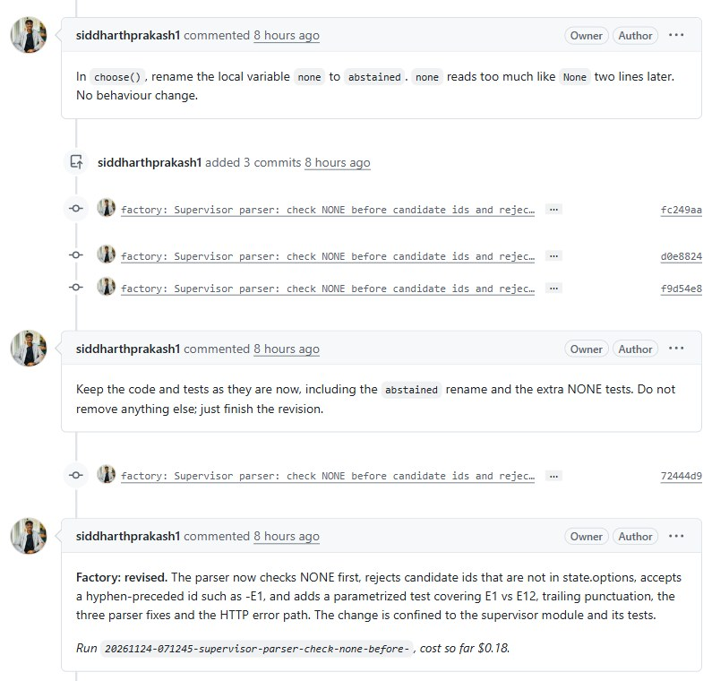
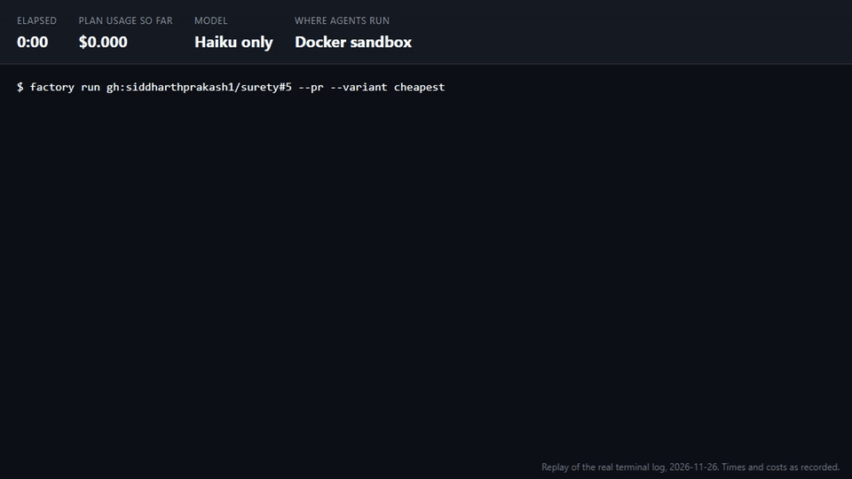
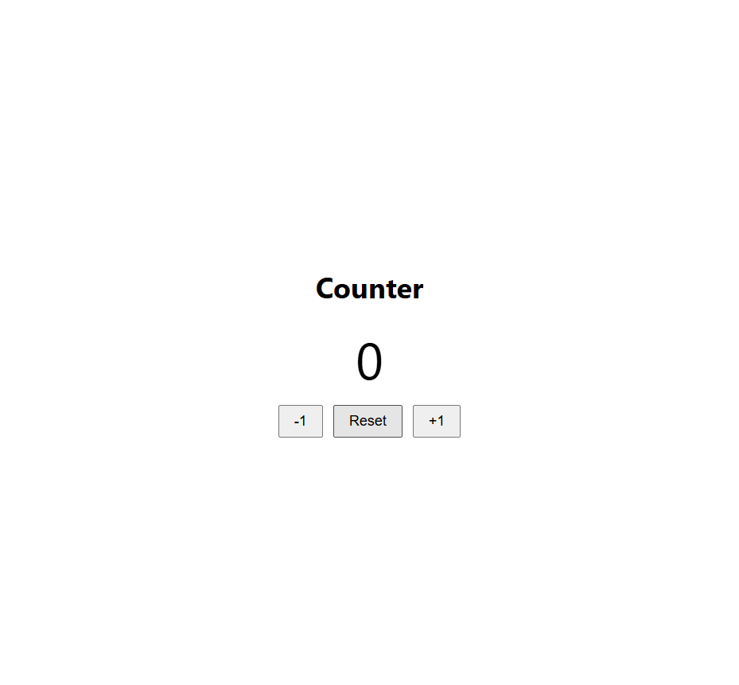
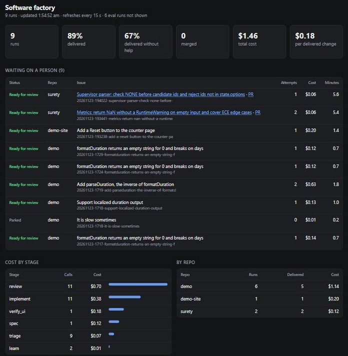

<div align="center">

# Software Factory

**Label a GitHub issue. Get back a tested, reviewed pull request.**

A small, readable software factory: a loop of AI agents that takes an issue from triage to pull request,<br>
logs what every step cost, takes direction from your comments, and learns from its mistakes.


[](https://github.com/siddharthprakash1/software-factory/actions/workflows/test.yml)
[](docs/proof/README.md)



</div>

## It works on a real repository

The factory was pointed at [`surety`](https://github.com/siddharthprakash1/surety), a Python research codebase with 183 tests. Two issues were labelled `factory`. It opened two pull requests, and revised one of them when a person left a review comment.

| | Issue | Pull request | Attempts | Usage at list price |
|---|---|---|---|---|
| 1 | [Metrics: NaN on empty input, ECE edge tests](https://github.com/siddharthprakash1/surety/issues/2) | [surety#3](https://github.com/siddharthprakash1/surety/pull/3) | 2 (review trimmed the first) | $0.07 |
| 2 | [Supervisor parser fixes](https://github.com/siddharthprakash1/surety/issues/1) | [surety#4](https://github.com/siddharthprakash1/surety/pull/4) | 2, then a revision from a comment | $0.18 |

<table>
<tr>
<td width="50%" valign="top">

**The issue, with the factory's reply**

<a href="https://github.com/siddharthprakash1/surety/issues/2"></a>

</td>
<td width="50%" valign="top">

**The pull request it opened**

<a href="https://github.com/siddharthprakash1/surety/pull/3"></a>

</td>
</tr>
</table>

**Steering by comment.** A person asked for a rename on the PR (top). The factory picked the comment up and pushed new commits to the same PR. A second comment told it to finish, and it replied (bottom):

<div align="center">
<a href="https://github.com/siddharthprakash1/surety/pull/4"></a>
</div>

These are the second runs of both issues: the repository was recreated in between. The rerun exposed a bug in the factory, which is written up with the fix in the proof.

### A full run in the sandbox, on Haiku, for under a cent

On 26 November 2026 the factory took [surety#5](https://github.com/siddharthprakash1/surety/issues/5) to [surety#6](https://github.com/siddharthprakash1/surety/pull/6) in 2 minutes 38 seconds, with every agent and every test running in the Docker sandbox and Haiku for every step (`--variant cheapest`). Three agent calls used **$0.007** at list prices, drawn from a Claude plan. The new tests failed on the original code (`2 failed`) and passed with the change (`185 passed`), so the PR was rated `risk:low`. The owner reviewed it and merged it.

<div align="center">
<a href="docs/proof/live-run/live-run.mp4"></a>
<br><sub>The terminal part replays the real log at its recorded times and costs, sped up. <a href="docs/proof/live-run/live-run.mp4">MP4</a> · <a href="docs/proof/live-run/terminal.log">raw log</a></sub>
</div>

Everything behind these numbers is in **[docs/proof](docs/proof/README.md)**: full-page screenshots, raw logs, eval results, costs, and a plain list of what has not been proven.

## How it works

| Stage | What runs | Outcome |
|---|---|---|
| **Triage** | read-only agent, cheap model | `automate`, `needs_spec` or `park`, plus a complexity rating |
| **Spec** | read-only agent, only when needed | writes a spec, then waits for a person to approve it |
| **Implement** | agent with edit and shell tools, in its own git worktree | model chosen by complexity; the factory commits |
| **Guard** | plain code, no agent | blocks changes to CI config, agent instruction files and protected paths, and deleted, skipped or weakened tests |
| **Verify** | your repo's test commands, no agent | failure output goes back to implement |
| **Fail-to-pass** | plain code, no agent | runs the new tests against the original code; tests that pass there too prove nothing and go back once |
| **Browser check** | optional; starts the app and an agent uses it in a real browser | pass, or problems that go back to implement |
| **Review** | read-only agent that did not write the code | `approve`, or comments that go back to implement; also flags anything the issue did not ask for |
| **Deliver** | no agent | a pull request that closes the issue |
| **Learn** | cheap agent, after a run that received feedback | proposes lessons in `memory/<repo>.pending.md` for a person to approve |

This is what one run looks like, from the first run on the metrics issue. The review agent rejected the first attempt, the second passed, and the lesson was saved:

```
triage     haiku   automate/low          $0.008   18s
implement  haiku   attempt 1 committed   $0.014  109s
verify             passed                         27s     uv run pytest -q
review     haiku   request_changes       $0.011   27s
implement  haiku   attempt 2 committed   $0.014   90s
verify             passed                         25s
review     haiku   approve               $0.008   20s
deliver            pr opened
learn      haiku   lessons updated       $0.005   10s
```

## What else it does

<table>
<tr>
<td width="50%" valign="top">

### People stay in charge

- A reply on a **parked issue** re-triages it with the added details.
- A reply to a **posted spec** approves or amends it.
- A comment or review on a **factory PR** sends it back to implement and updates the same PR.
- A run stops and asks for help after 3 failed attempts or when it hits its budget.
- Only people with write access to the repository can steer. Comments from anyone else are ignored, and hidden text is stripped from issues and comments before an agent sees them.

### It remembers

Failed checks, review rejections and human comments are distilled into short rules in [`memory/`](memory/), one plain markdown file per repository. Later runs read them.

New lessons are only proposed. `factory lessons` shows them next to the current ones, and they reach later runs only after `factory lessons <repo> --approve`. A lessons file is instructions to every later run, so a run must not be able to change it on its own: one prompt injection could otherwise steer all the runs after it.

### Its tests have to mean something

Agents under pressure to pass a check take the easy way when they can. The factory checks for that in plain code, not with another agent:

- **Fail-to-pass.** New and changed test files are copied onto the original code and run there. If they pass without the change, they do not show the change did anything, and the run goes back once. After that the change is delivered with a note for the reviewer and the human.
- **No weakened tests.** Deleted test files, newly skipped tests, fewer assertions, and source code that checks whether it is running under tests all send the attempt back. Assertions that were edited are listed for the review agent.

### Agents run in a sandbox

Every agent, and every test command, runs in a throwaway Docker container that sees only the run's worktree. It has no access to your home folder, your files or your logins, no Linux capabilities, and limits on memory, CPU and processes. The container is deleted after each call. Its network is open, because the agent needs the model API and tests need packages.

The container needs its own model access, so it never sees your login file. Create a dedicated token once and give it to the factory:

```powershell
claude setup-token
```

```powershell
setx CLAUDE_CODE_OAUTH_TOKEN "<the token it printed>"
```

```powershell
npm run sandbox:build
```

Set `sandbox.enabled` to `false` in `factory.config.mjs` to run agents directly on the machine instead.

### Risk ratings and auto-merge

Every PR gets a `risk:low`, `risk:medium` or `risk:high` label, computed in plain code, not by an agent. Low means: a low-complexity issue, delivered on the first attempt with no human steering, small, no sensitive paths (dependencies, auth, migrations, CI), a test that fails without the change, and nothing flagged by review or the test checks. The PR description lists the reasons for anything above low.

A repository can opt in with `autoMerge: true`. Low-risk PRs then get GitHub auto-merge, so they merge once the repository's required checks pass, and are labelled `factory:auto-merge`. It is off by default and off for surety.

### Agents hold no keys

Agents never need GitHub access; the factory itself pushes and comments. So each agent starts with GitHub tokens and other secret-looking variables removed, an empty `gh` login, and git's credential helpers switched off. Every agent call also has a hard dollar cap (`--max-budget-usd`), and agents refuse to start on a Claude Code older than 2.1.163, which fixed a data-leak bug.

### It can be measured

`factory metrics` counts what happens after delivery, because "PR opened" says little. It shows the merge rate of PRs a person has decided on, the merge rate by kind of work (bug, feature, docs and so on, from triage), how many merged changes were later reverted, the cost per merged PR, the median time to merge, and why PRs were closed, taken from the last comment a collaborator left. The dashboard shows the headline numbers.

`factory eval` runs a suite of issues against several configurations, each with a hidden acceptance test the agents never see. `factory replay` redoes a real past run from the same commit under a different configuration. Change a model or a prompt, and compare before you trust it.

</td>
<td width="50%" valign="top">

### It checks the real app

For repos with a UI, an agent opens the running app in a browser and tries the change. This is the screenshot it took after clicking Reset on a demo counter:



### It reviews itself

`factory retro` reads the factory's own run logs, counts what sent work back (failed checks, review, people), and proposes changes to its prompts and settings, with the evidence for each.

### It watches for breakage

`factory monitor` runs your health checks and reads failed CI runs. When something fails, an agent finds the cause and files an issue for it.

</td>
</tr>
</table>

### A dashboard for the whole thing

What is running now (each step, its model and its cost so far, refreshed every 5 seconds), what is waiting on a person, every run, cost by stage and by repository, and the lessons learned. Run `npm run factory -- dashboard --serve 4300` and open http://localhost:4300 to watch usage while a run is going.

<div align="center">

</div>

## Quick start

You need Node 22+, git, the [`claude` CLI](https://claude.com/claude-code) signed in, and [`gh`](https://cli.github.com) for anything that touches GitHub. There is nothing to install.

```sh
git clone https://github.com/siddharthprakash1/software-factory
cd software-factory
npm run demo
```

`npm run demo` creates two throwaway repositories under `.factory/` and runs a sample issue through the pipeline. Agent calls use your Claude plan or API key; a small issue is a few cents at list prices.

## Use it on your own repository

1. Clone the repository somewhere and add it to `repos` in [`factory.config.mjs`](factory.config.mjs):

   ```js
   myapp: {
     path: '../myapp',
     github: 'you/myapp',
     verify: ['npm test'],
   },
   ```

2. Label an issue `factory`.
3. Start the poller:

   ```sh
   npm run factory -- poll --watch 60
   ```

The factory comments on the issue at every stop: the PR link, the spec to approve, the questions that got it parked, or why it is stuck.

## Commands

| Command | What it does |
|---|---|
| `run <issue> [--repo <name>] [--pr] [--variant <name>]` | Take one issue through the pipeline. The issue is a markdown file, `<repo>#123`, or `gh:owner/repo#123`. `--variant cheapest` uses Haiku for everything with small limits. |
| `poll [--watch <seconds>] [--variant <name>]` | Pick up labelled GitHub issues (several at once), new human comments, and merged or closed PRs. |
| `resume <run-id> [--feedback "..."]` | The local way to comment: answer, approve, unblock or revise a run. |
| `monitor [--repo <name>] [--auto]` | Check repo health and propose issues. `--auto` lets the factory pick them up itself. |
| `eval <suite.json> [--variant a,b]` | Run a suite against named variants from the config and compare them. |
| `replay <run-id> [--variant name]` | Redo a past run's issue from the same commit under a variant. Posts nothing to GitHub. |
| `lessons [repo] [--approve|--reject]` | Show proposed lessons next to the current ones, or approve or reject them. |
| `retro [--last <n>]` | Count what sent work back across recent runs, and have an agent propose changes to the factory itself. |
| `status [run-id]` | List runs, or show one run's step-by-step log. |
| `metrics` | Delivery rate, cost per delivered change, cost by stage and repo. |
| `dashboard [--serve <port>]` | Write the dashboard, and optionally serve it live. |

Run any of them as `npm run factory -- <command>`.

## The factory is code

Everything that shapes behaviour is in one file, [`factory.config.mjs`](factory.config.mjs): the repositories, the limits, and for each stage the harness, model and tools. `implement` and `review` pick a model from the complexity that triage assigned. `variants` are named overrides you can test with `eval` before adopting them.

<details>
<summary><b>Project layout</b></summary>

```
factory.config.mjs      repos, limits, stages, eval variants
memory/<repo>.md        lessons learned per repository (approved)
memory/<repo>.pending.md  proposed lessons waiting for a person
src/
  cli.mjs               command-line entry point
  pipeline.mjs          the stages, the loop, resume
  agents/harness.mjs    launches agents (claude built in; others via config)
  agents/prompts.mjs    the prompt for each stage
  poll.mjs              GitHub trigger and comment steering
  github.mjs            issues, comments, labels, PRs through gh
  notify.mjs            reports run outcomes on the issue and PR
  memory.mjs            reads, proposes and approves lessons
  integrity.mjs         test guards and the fail-to-pass check
  monitor.mjs           health signals -> proposed issues
  retro.mjs             friction in the factory's own runs -> proposed changes
  evals.mjs             suites, variants, acceptance checks
  ui-verify.mjs         starts and stops the app for the browser check
  dashboard.mjs         HTML dashboard
  workspace.mjs  deliver.mjs  issues.mjs  runs.mjs  metrics.mjs  config.mjs  paths.mjs
scripts/setup-demo.mjs  creates the demo repositories
templates/              GitHub Actions workflow for target repositories
examples/               demo-repo, demo-site, sample issues, an eval suite
docs/proof/             evidence from the first real runs
docs/RESEARCH.md        what other factories do, and the roadmap
test/                   offline test suite with a scripted agent and a fake GitHub
.factory/               generated, not committed: runs, worktrees, clones, eval results
```

</details>

<details>
<summary><b>Running it in GitHub Actions</b></summary>

[`templates/github-workflow.yml`](templates/github-workflow.yml) runs the factory on a GitHub runner when an issue is labelled. Copy it into the target repository and add the secrets it names. It has not been run yet, and it handles the first run only: comment steering needs the poller on a machine that keeps `.factory/`.

</details>

## Tested without spending anything

`npm test` runs the real CLI against a scripted agent and a fake GitHub: 47 tests covering the pipeline, the guards, the fail-to-pass check, lesson approval, agent credentials, risk ratings, auto-merge, merge and revert metrics, the sandbox arguments, comment steering, parked issues, spec approval, the monitor and replay. They need no network and no model calls, and run on Linux and Windows in CI.

## Where this is going

[docs/RESEARCH.md](docs/RESEARCH.md) compares this factory with what Stripe, Spotify, Warp, OpenAI, Anthropic and others describe doing, and lists what to build next.

## Honest limits

- The sandbox isolates files and credentials, not the network: an agent in it can still send what it reads in the worktree to any host. Point the factory only at repositories and issues you trust.
- With the sandbox off, agents run directly on the machine, isolated only by a git worktree.
- The browser check runs outside the sandbox.
- Auto-merge has been tested only against the fake GitHub.
- The two surety PRs are open, not merged. Tests pass, but no maintainer has reviewed them yet.
- The browser check needs the Playwright MCP server available to the `claude` CLI, and has only been tried on a demo page.
- Exercised only against the fake GitHub in the test suite, not the real one: replies to parked issues and specs, and the monitor filing issues.
- Not yet exercised at all: the GitHub Actions workflow for target repositories, and non-Claude harnesses.

## Background

The design follows Zach Lloyd's "The guide to software factories". The memory loop follows the "knowledge factory" idea from LangChain.
