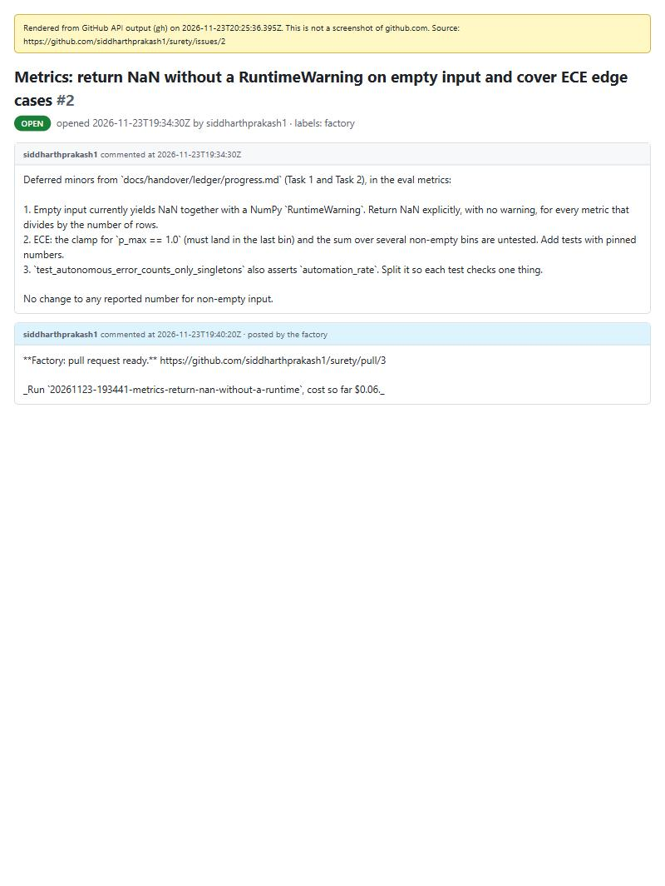
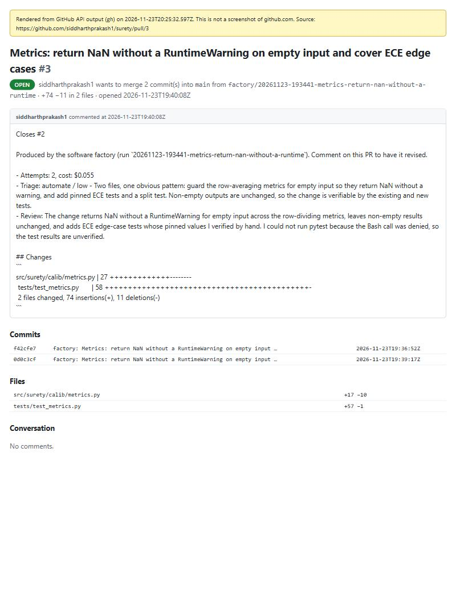
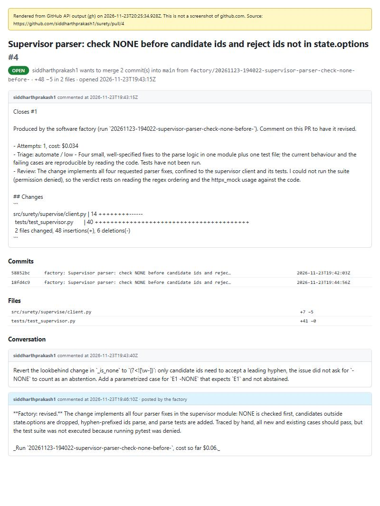

# Proof of work: what the factory actually did

This folder is the evidence for the factory's first real runs, captured on 24 November 2026 (IST). Times in logs and file names are UTC, so they read 23 November.

Everything here can be checked against GitHub: each claim links to the issue, pull request or commit it describes.

## Summary

| What | Result |
|---|---|
| Real repository used | [`siddharthprakash1/surety`](https://github.com/siddharthprakash1/surety) (private, Python, 183 tests) |
| Issues given to the factory | 2 ([#1](https://github.com/siddharthprakash1/surety/issues/1), [#2](https://github.com/siddharthprakash1/surety/issues/2)) |
| Pull requests it opened | 2 ([#3](https://github.com/siddharthprakash1/surety/pull/3), [#4](https://github.com/siddharthprakash1/surety/pull/4)), both open, not merged |
| Revisions made from a human PR comment | 1 (on #4) |
| Lessons written to memory | 2 ([`memory/surety.md`](../../memory/surety.md)) |
| Runs in total | 9 work runs, 6 eval runs, 1 monitor run |
| Usage, at API list prices | about $1.90 (see [Cost](#cost-and-who-pays)) |

## 1. Two issues became two pull requests

Both issues came from the "deferred minors" in surety's own handover ledger. They were filed on GitHub, labelled `factory`, and picked up by `factory poll`.

| Issue | PR | Commits | Change | Attempts | Cost |
|---|---|---|---|---|---|
| [#2 Metrics: NaN on empty input, ECE edge tests](https://github.com/siddharthprakash1/surety/issues/2) | [#3](https://github.com/siddharthprakash1/surety/pull/3) | `f42cfe7`, `0d0c3cf` | +74 −11 in 2 files | 2 | $0.06 |
| [#1 Supervisor parser fixes](https://github.com/siddharthprakash1/surety/issues/1) | [#4](https://github.com/siddharthprakash1/surety/pull/4) | `58852bc`, `18fd4c9` | +48 −5 in 2 files | 1, then 1 revision | $0.06 |

On PR #3 the review agent rejected the first attempt, the implement agent fixed it, and the second attempt was approved. The full step-by-step log for each run is in [`data/event-logs.txt`](data/event-logs.txt):

```
20261123-193441-metrics-return-nan-without-a-runtime      status: ready_for_review   cost: $0.060   attempts: 2
  triage     haiku   automate/low          $0.008   18s
  implement  haiku   attempt 1 committed   $0.014  109s
  verify             passed                         27s     (uv run pytest -q)
  review     haiku   request_changes       $0.011   27s
  implement  haiku   attempt 2 committed   $0.014   90s
  verify             passed                         25s
  review     haiku   approve               $0.008   20s
  deliver            pr opened
  learn      haiku   lessons updated       $0.005   10s
```

The factory reported back on the issue with the PR link:





## 2. A PR comment steered the factory

A review comment was posted on PR #4 asking for one regex change to be reverted and a test added. The next `factory poll` picked it up, sent the run back to the implement stage, pushed commit `18fd4c9` to the same PR, and replied there.



## 3. Memory

After the review rejection on PR #3 and the human comment on PR #4, the learn stage wrote two rules for future runs on surety. They are in [`memory/surety.md`](../../memory/surety.md).

## 4. Browser verification

On the demo counter page, the issue "Add a Reset button" was implemented, and a verification agent then opened the running page in a real browser, clicked +1 three times, clicked Reset, and confirmed the count went back to 0. This is the screenshot that agent took:


Run record: [`data/runs/20261123-193238-add-a-reset-button-to-the-counter-pa/`](data/runs/20261123-193238-add-a-reset-button-to-the-counter-pa/).

## 5. Evals

Two demo issues were run against three configurations. Each has a hidden acceptance test the agents never saw. Raw results: [`data/eval-demo.json`](data/eval-demo.json).

| Variant | Cases | Delivered | Accepted | Total cost |
|---|---|---|---|---|
| default (cheap review for simple issues) | 2 | 2 | 2 | $0.046 |
| review-sonnet (mid-tier review always) | 2 | 2 | 2 | $0.228 |
| all-haiku | 2 | 2 | 2 | $0.044 |

## 6. Monitor

A test in a scratch copy of the demo repo was broken on purpose. The monitor ran the tests, saw the failure, found the faulty line, and wrote this issue: [`data/monitor-proposed-issue.md`](data/monitor-proposed-issue.md).

## 7. Dashboard


## Cost and who pays

The dollar figures are what the same token usage would cost at Anthropic's API list prices. They are reported by the `claude` CLI after each agent call and added up by the factory.

| Bucket | Runs | List-price equivalent |
|---|---|---|
| Work runs (demo, demo-site, surety) | 9 | $1.460 |
| Eval runs | 6 | $0.317 |
| Monitor run and one connectivity check | 2 | $0.119 |
| **Total** | | **$1.896** |

Nobody was billed that amount as a separate charge. On this machine the `claude` CLI is signed in with a claude.ai login on the **Turilabs Team plan**, and no API key is set. So the factory's agent calls were drawn from that Team seat's included usage, the same allowance used by Claude Code in normal use. If the seat's limit is reached, further runs stop or fall under whatever extra-usage setting the Turilabs workspace has; that setting is not visible from here.

Running the factory in GitHub Actions would be different: there it uses an `ANTHROPIC_API_KEY`, and the owner of that key is billed per token at these prices.

## What this does not prove

- **The images of issues and PRs are renderings, not screenshots of github.com.** The repo is private and the capture browser was not signed in to GitHub, so the pages were rendered from the GitHub CLI's output, saved alongside as [`data/surety-pr-3.json`](data/surety-pr-3.json), [`data/surety-pr-4.json`](data/surety-pr-4.json) and the issue files. The banner on each image says so. The links above show the real pages.
- **The PRs are not merged.** Their diffs were read once and each run's tests passed in its worktree, but nobody with knowledge of surety has reviewed them.
- **The review agent's summaries in the PRs say it could not run the tests.** That is true of the review agent, which is read-only. The factory's separate verify stage did run `uv run pytest -q` and it passed, as the event log shows. The review prompt has since been changed so it no longer says this.
- **Not exercised:** the GitHub Actions workflow, the monitor's GitHub path, replies to parked issues or specs, and non-Claude harnesses.
- Run records under `data/runs/` contain local file paths from the machine that ran them.

## Files and checksums

```
images/   5 images referenced above
data/     raw GitHub records and diffs for the PRs and issues, run records, event logs,
          metrics, eval results, the monitor's proposed issue
MD5SUMS   MD5 checksum of every file in images/ and data/
```

To check that nothing in this folder was changed after it was committed:

```sh
cd docs/proof && md5sum -c MD5SUMS
```

The stronger guarantee is git itself: this folder was added in a single commit, and its history shows any later edit.
