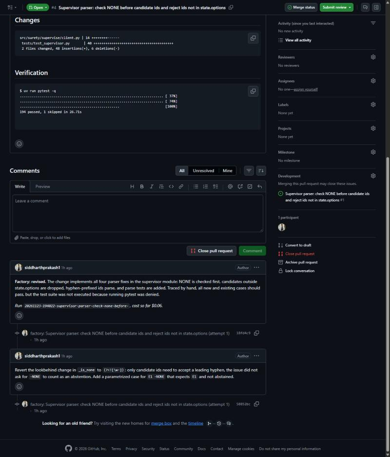
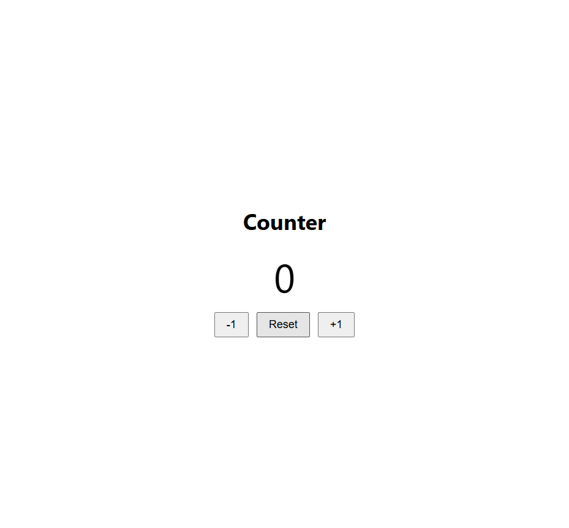
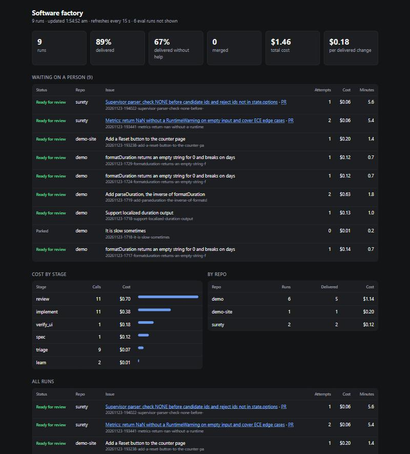
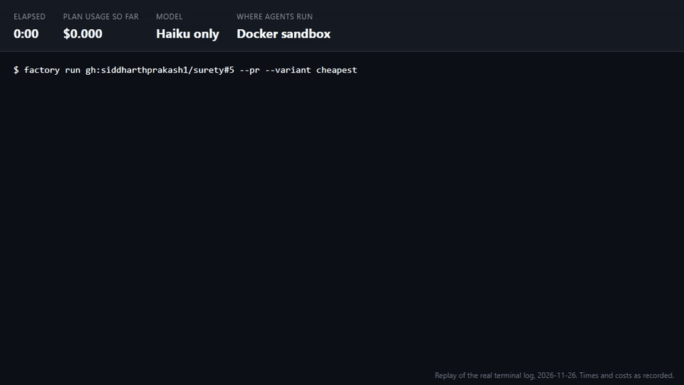
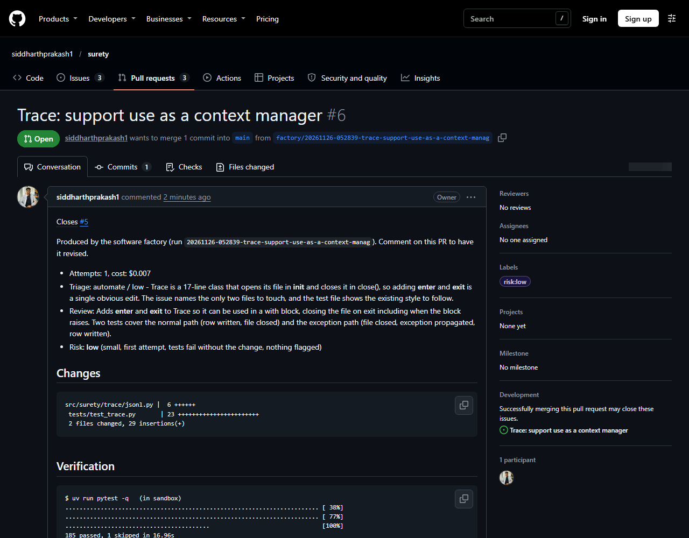
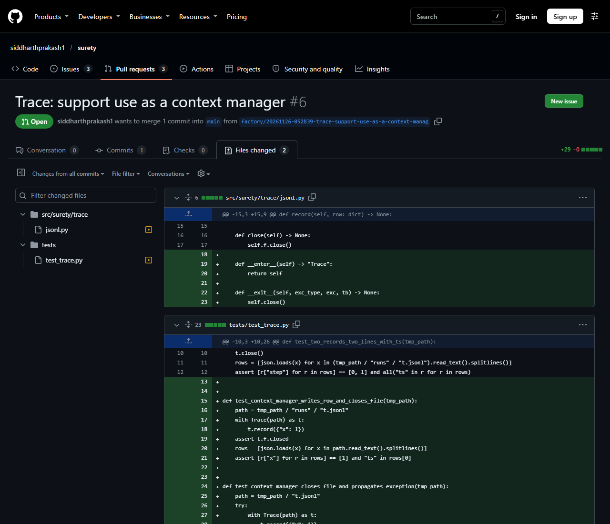
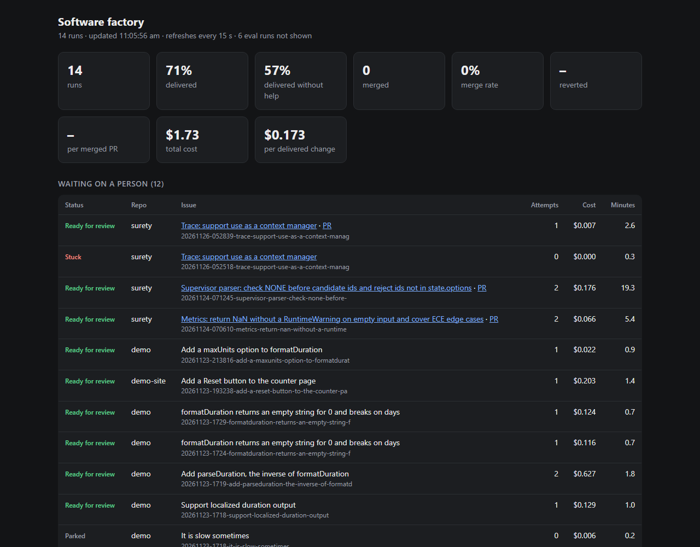
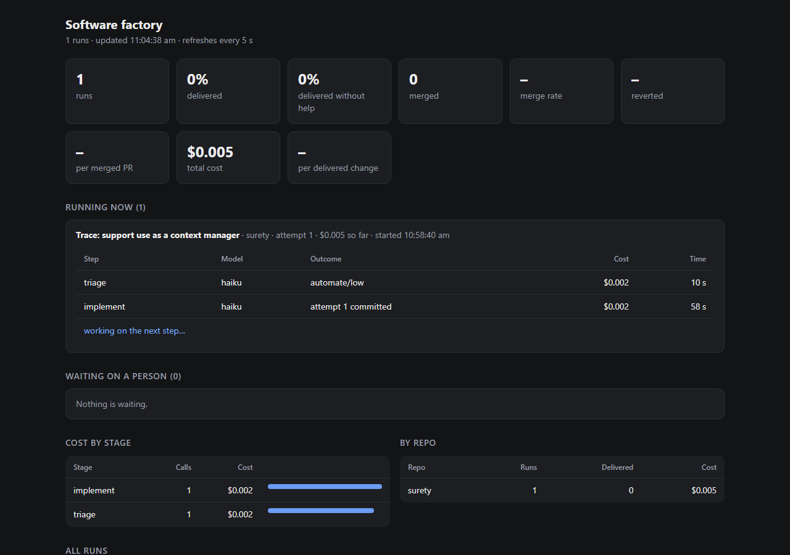

# Proof of work: what the factory actually did

This folder is the evidence for the factory's runs on a real repository. Times in logs and file names are UTC.

Everything here can be checked against GitHub: each claim links to the issue, pull request or commit it describes.

**These are the second runs of the same two issues.** The factory first handled them on 23 November 2026. On 24 November the surety repository was recreated with rewritten commit history, which removed its issues and pull requests, so the same two issues were filed again and the factory ran on them again. The records and numbers below are from that rerun.

## Summary

| What | Result |
|---|---|
| Real repository used | [`siddharthprakash1/surety`](https://github.com/siddharthprakash1/surety) (Python, 183 tests) |
| Issues given to the factory | 2 ([#1](https://github.com/siddharthprakash1/surety/issues/1), [#2](https://github.com/siddharthprakash1/surety/issues/2)) |
| Pull requests it opened | 2 ([#3](https://github.com/siddharthprakash1/surety/pull/3), [#4](https://github.com/siddharthprakash1/surety/pull/4)), both open, not merged |
| Revisions made from a human PR comment | 1 (on #4), which also exposed a factory bug, described below |
| Lessons in memory | 5 ([`memory/surety.md`](../../memory/surety.md)) |
| Runs in total | 12 work runs (2 of them the superseded first runs), 6 eval runs, 1 monitor run, 1 retro |
| Usage, at API list prices | about $2.27 (see [Cost](#cost-and-who-pays)) |

## 1. Two issues became two pull requests

Both issues came from the "deferred minors" in surety's own handover ledger. They were filed on GitHub, labelled `factory`, and picked up by `factory poll`.

| Issue | PR | Commits | Change | Attempts | Cost |
|---|---|---|---|---|---|
| [#2 Metrics: NaN on empty input, ECE edge tests](https://github.com/siddharthprakash1/surety/issues/2) | [#3](https://github.com/siddharthprakash1/surety/pull/3) | `03dedb2`, `d651a5c` | +66 −8 in 2 files | 2 | $0.07 |
| [#1 Supervisor parser fixes](https://github.com/siddharthprakash1/surety/issues/1) | [#4](https://github.com/siddharthprakash1/surety/pull/4) | `d390599`, `9d3b7d2`, then 4 more from the revision | +37 −4 in 2 files | 2, then a revision | $0.18 |

On both issues the review agent approved the first attempt but listed changes the issue had not asked for, so the implement agent trimmed them and the second attempt was delivered. The full step-by-step log for each run is in [`data/event-logs.txt`](data/event-logs.txt):

```
20261124-070610-metrics-return-nan-without-a-runtime      status: ready_for_review   cost: $0.066   attempts: 2
  triage     haiku   automate/low               $0.011   33s
  implement  haiku   attempt 1 committed        $0.017  105s
  verify             passed                              20s     (uv run pytest -q)
  review     haiku   approve, with scope notes  $0.010   31s
  implement  haiku   attempt 2 committed        $0.012   70s
  verify             passed                              20s
  review     haiku   approve                    $0.011   37s
  deliver            pr opened
  learn      haiku   lessons updated            $0.005    8s
```

The factory reported back on each issue with the PR link. Each PR description is written by the factory and includes the test run from its verify stage (195 passed on #3).

## 2. A PR comment steered the factory, and showed a bug in it

A comment on PR #4 asked for one local variable to be renamed. The next `factory poll` picked it up and sent the run back to the implement stage, which made the rename.

Then the run got stuck. The review agent approved the change three times, and each time also listed something "beyond the issue" (an extra test, a new local variable). The factory treated every such note as a reason to send the change back, used up its three attempts, and stopped with "stuck, needs a person" on the issue. That was a defect in the factory, not in the change.

The fix, in this repository: scope notes now send a change back once. If the reviewer still has some after that, the change is delivered and the notes are shown to the human reviewer in the report. The review prompt also says not to list things the request needs. A second comment on the PR then let the run finish; it pushed the revision and replied on the PR.

The whole sequence is in the event log for run `20261124-071245-supervisor-parser-check-none-before-`, and on [PR #4](https://github.com/siddharthprakash1/surety/pull/4) and [issue #1](https://github.com/siddharthprakash1/surety/issues/1).

### Screenshots

These are screenshots of the public github.com pages, taken signed out on 24 November 2026 after the rerun. The last two show the PR #4 conversation and its six commits: two from the first delivery, three from the stuck revision, and one from the finish.





## 3. Memory

The learn stage writes rules for future runs on surety after each run that received feedback. They are in [`memory/surety.md`](../../memory/surety.md).

The rerun also showed how memory can go wrong. While the scope-check bug was sending good work back, the learn stage turned that feedback into two bad rules ("do not add tests the issue does not name", "do not introduce new locals"). Those were removed by hand. A lessons file needs review like any other change.

## 4. Browser verification

On the demo counter page, the issue "Add a Reset button" was implemented, and a verification agent then opened the running page in a real browser, clicked +1 three times, clicked Reset, and confirmed the count went back to 0. This is the screenshot that agent took:



Run record: [`data/runs/20261123-193238-add-a-reset-button-to-the-counter-pa/`](data/runs/20261123-193238-add-a-reset-button-to-the-counter-pa/).

## 5. Evals

Two demo issues were run against three configurations. Each has a hidden acceptance test the agents never saw. Raw results: [`data/eval-demo.json`](data/eval-demo.json).

| Variant | Cases | Delivered | Accepted | Total cost |
|---|---|---|---|---|
| default (cheap review for simple issues) | 2 | 2 | 2 | $0.046 |
| review-sonnet (mid-tier review always) | 2 | 2 | 2 | $0.228 |
| all-haiku | 2 | 2 | 2 | $0.044 |

## 6. Monitor

A test in a scratch copy of the demo repo was broken on purpose. The monitor ran the tests, saw the failure, found the faulty line, and wrote this issue: [`data/monitor-proposed-issue.md`](data/monitor-proposed-issue.md).

## 7. Dashboard



## 8. A full run in the Docker sandbox, on Haiku only

On 26 November 2026 the factory ran issue [surety#5](https://github.com/siddharthprakash1/surety/issues/5) ("Trace: support use as a context manager") with the sandbox on and the `cheapest` variant: Haiku for every agent step, at most 2 attempts, $0.40 per agent call, $1 per run, and no lessons step.

| Step | Where | Model | Result | List-price usage | Time |
|---|---|---|---|---|---|
| triage | sandbox | Haiku | automate, low complexity | $0.0023 | 10 s |
| implement | sandbox | Haiku | 1 commit, 2 files, +29 lines | $0.0025 | 58 s |
| verify | sandbox | – | `185 passed, 1 skipped` | – | 41 s |
| fail to pass | sandbox | – | new tests on the original code: `2 failed, 1 passed` | – | 28 s |
| review | sandbox | Haiku | approve | $0.0021 | 10 s |
| deliver | host | – | [surety#6](https://github.com/siddharthprakash1/surety/pull/6), labelled `risk:low` | – | – |
| **Total** | | | | **$0.007** | **2 min 38 s** |

Each Haiku call read 43,000 to 66,000 tokens, mostly from cache, which is why the calls are so cheap.

The repository owner read the diff and squash-merged the PR on 26 November 2026 ([`6fecbda`](https://github.com/siddharthprakash1/surety/commit/6fecbdaf7a98204506538a7b82f8d82ba15e63f1)), which closed the issue. It is the first factory PR merged on surety, and the factory recorded the merge on its next poll.



The terminal part of the video is a replay rendered from the saved log ([`live-run/terminal.log`](live-run/terminal.log)) and the run record, with the recorded times and costs, sped up. The dashboard and GitHub frames are screenshots taken after the run; GitHub was opened signed out.

| | |
|---|---|
|  |  |
|  |  |

The bottom-right image shows the dashboard's "Running now" view, added after this run. It is rendered from this run's real record, cut back to the point after the implement step; it was not captured while the run was going.

**The first attempt failed before it started.** The token for the sandbox had been saved with spaces in it, as happens when a long token is copied from a wrapped terminal line. Inside the container Claude reported "Not logged in", and the run stopped at triage having used nothing. It is kept as the `Stuck` row on the dashboard. The factory now removes whitespace from the model token before passing it to the container.

Raw records: [`data/runs/20261126-052839-trace-support-use-as-a-context-manag/`](data/runs/20261126-052839-trace-support-use-as-a-context-manag/), [`data/surety-pr-6.json`](data/surety-pr-6.json), [`data/surety-pr-6.diff`](data/surety-pr-6.diff), [`data/surety-issue-5.json`](data/surety-issue-5.json).

## Cost and who pays

The dollar figures are what the same token usage would cost at Anthropic's API list prices. They are reported by the `claude` CLI after each agent call and added up by the factory.

| Bucket | Runs | List-price equivalent |
|---|---|---|
| Work runs (demo, demo-site, surety) | 12 | $1.724 |
| Eval runs | 6 | $0.317 |
| Monitor run, retro and one connectivity check | 3 | $0.226 |
| **Total** | | **$2.267** |

Nobody was billed that amount as a separate charge. On this machine the `claude` CLI is signed in with a claude.ai login on a **Claude Team plan**, and no API key is set. So the factory's agent calls were drawn from that Team seat's included usage, the same allowance used by Claude Code in normal use. If the seat's limit is reached, further runs stop or fall under whatever extra-usage setting that workspace has; that setting is not visible from here.

Running the factory in GitHub Actions would be different: there it uses an `ANTHROPIC_API_KEY`, and the owner of that key is billed per token at these prices.

## What this does not prove

- **A screenshot can be edited.** The raw GitHub CLI records of the same pages are saved as [`data/surety-pr-3.json`](data/surety-pr-3.json), [`data/surety-pr-4.json`](data/surety-pr-4.json) and the issue files. The links are the final check.
- **The PRs are not merged.** Each run's tests passed in its worktree, but nobody with knowledge of surety has reviewed the diffs.
- **The rerun had an advantage:** the two lessons learned on the first runs were already in memory.
- **PR #4's description shows the numbers from when it was opened.** The factory pushes revisions and comments, but does not rewrite the description.
- **Not exercised on real GitHub:** the GitHub Actions workflow, the monitor's GitHub path, replies to parked issues or specs, and non-Claude harnesses.
- Run records under `data/runs/` contain local file paths from the machine that ran them.

## Files and checksums

```
images/   7 images referenced above
live-run/ the sandboxed Haiku run: video, GIF, screenshots, terminal log
data/     raw GitHub records and diffs for the PRs and issues, run records, event logs,
          metrics, eval results, the monitor's proposed issue
MD5SUMS   MD5 checksum of every file in images/, live-run/ and data/
```

To check that nothing in this folder was changed after it was committed:

```sh
cd docs/proof && md5sum -c MD5SUMS
```

The stronger guarantee is git itself: the history of this folder shows every edit, including the replacement of the first runs' records by the rerun's on 24 November 2026.
